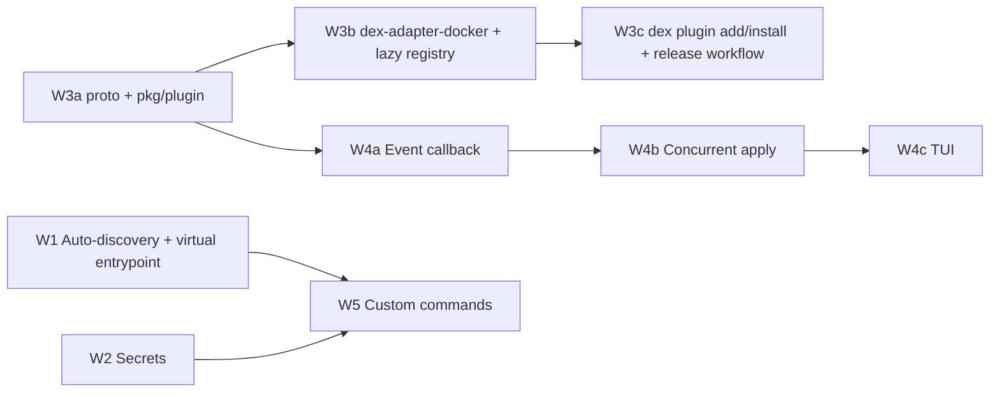

# Phase 2 plan: Extensibility & Organization (V1)

**Goal (ROADMAP Phase 2):** make `dex` usable for real homelabs. That means configs split across files, secrets that never reach IR or state, adapters shipped as separate gRPC binaries installable with `dex plugin add`/`dex plugin install`, custom commands, and a TUI showing apply progress.

**Status:** confirmed across two `/grill-with-docs` rounds (Q1–Q17). Decisions below are **D1–D13**, the same numbers as the original P1–P13 proposals; D9 reverses its proposal, D12 deviates from SPEC. Three decisions were hard enough to reverse or surprising enough to need a written reason, recorded as ADRs rather than left in this plan: `docs/adr/0001-accept-go-plugin-mpl-license.md`, `0002-hmac-secret-hashing.md`, `0003-plugins-declared-in-ir.md`. Two new terms came out of the session and are now in `GLOSSARY.md`: **Secret**, **Command**.

## Phase 1 verification

`task check` is green at `7f14b46`: lint, vet, shadow, Go tests at 100% coverage on every module, and SDK tests at 100%. Every Phase 1 checkbox matches the code:

| ROADMAP item | Where it lives |
|---|---|
| SDK `defineDexConfig`/`service`/`env`/`synth` | `packages/sdk/src/scope.ts`, `index.ts` (also `volume`, `network`) |
| Cobra `init`/`plan`/`apply` | `cmd/dex/internal/cli/{init,plan,apply}.go` |
| esbuild in-memory transpile | `pkg/jsenv/bundler.go` `EsbuildBundler.Bundle` (single file entry, `sdkPlugin` resolves `@dex/iac`) |
| goja evaluation | `pkg/jsenv/evaluator.go` `GojaEvaluator.Evaluate` (10s budget, `__dex_env` in, `__dex_synth()` out) |
| DAG | `pkg/engine/dag/dag.go`; used only by `diff.Compute` to order changes |
| State + lock | `pkg/engine/state/{file,lock}.go` |
| Diff | `pkg/engine/diff/diff.go` (tainted → replace, deletes reverse-ordered) |
| Docker adapter | `adapters/docker` (own module), bridged by `cmd/dex/internal/cli/docker.go` `dockerAdapter` → `engine.Adapter` |

These facts matter for Phase 2:

- `engine.Apply` runs `plan.Changes` **serially** and reports through `Options.Events func(Event)` (D11's callback; the CLI sink in `root.go` `applySink` renders today's `"%s: done"` lines). There is no fan-out bus and no concurrency.
- `engine.Adapter` is `Create`/`Update`/`Delete`. `Update` receives the current `state.Resource`, and `docker.Adapter.Update` needs the prior properties for its restart-only fast path (Phase 1 D5).
- The env passed to `env()` comes from process env only (`root.go` `envMap`). `.env` is scaffolded by `dex init` but never read.
- `dex init` already creates `dex/services/.gitkeep`, but nothing reads that directory.
- `ir.Validate` never checks the `plugin` field's shape. Once plugins become file paths (W3), that field is a path-traversal vector.
- There's no signal handling: `root.Execute()` runs with a background context. Ctrl-C can't cancel adapter calls, and once plugins exist it would orphan their processes.
- The coverage gate (`scripts/check-coverage.sh`) excludes only `cmd/dex/main.go` and `pkg/jsenv/sdk/gen/main.go`. Generated protobuf code and new `main.go` files have to be added to that filter.

## Contradictions found, now resolved

| # | Conflict | Resolved by |
|---|---|---|
| C1 | SPEC §5.2 proto has `Configure`/`Read`/`Apply`/`Destroy`, and `ApplyRequest` carries only `resource_id` + `properties_json`. The engine's seam is Create/Update/Delete with the prior state passed in. | D5 |
| C2 | SPEC §3 said `.env` is "never serialized to IR," but `env()` returns plaintext into properties. | D3 |
| C3 | AGENTS.md put adapter binaries at `cmd/dex-adapter-<target>`; SPEC §2 put them under `adapters/docker`. | D6 |
| C4 | SPEC §4 said "iterates the DAG concurrently," but the engine is serial and concurrency wasn't a ROADMAP item. | D10 |
| C5 | PROJECT.md's "internal Event Bus" doesn't exist. | D11 |
| C6 | AGENTS.md's MIT-only dependency policy vs. SPEC's mandated `hashicorp/go-plugin` (MPL-2.0). | D4, `docs/adr/0001` |
| C7 | PROJECT.md implied one repo per adapter; the first-party Docker adapter ships from the monorepo. | D8 |
| C8 | `.dex/plugins/` is gitignored, so nothing made a fresh clone reproducible; `dex.config.ts`'s claimed "plugin setup" did nothing. | D9, `docs/adr/0003` |
| C9 | PROJECT.md said `.dex-state.json`; the code uses `.dex/state.json`. | Fixed directly in `PROJECT.md`, no decision needed. |

## Decisions

| # | Decision |
|---|---|
| D1 | **Discovery:** the entry imports `dex.config.ts` first, then every `dex/services/**/*.ts` in sorted slash-path order. `*.d.ts` and dot-prefixed directories are skipped, and a missing `dex/services/` is fine. The registry is name-keyed and `buildIR` sorts, so import order only makes the "first error" deterministic. |
| D2 | **Virtual entrypoint:** esbuild `BuildOptions.Stdin{Contents, ResolveDir: dir, Sourcefile: "dex:entry", Loader: LoaderTS}`, one `import "./<path>";` line per file. **Prototyped:** two service files plus a nested cross-file import bundle into one IR, the shared module evaluates once, all files share one `@dex/iac` registry. The scaffold moves `whoami` into `dex/services/whoami.ts`, leaving `dex.config.ts` holding only `defineDexConfig`. |
| D3 | **Env and `.env`:** load `<dir>/.env` with a minimal parser: `KEY=VALUE`, `#` comments, an optional `export ` prefix, one level of matching quotes stripped. No interpolation, no multiline. Process env overrides `.env`. That one map feeds both `env()` and `secret()`. SPEC §3 reworded: "`.env` values reach IR only through `env()`; `secret()` values never do." |
| D4 | **go-plugin:** adopted despite its MPL-2.0 license — see `docs/adr/0001`. Sign-off recorded in AGENTS.md's License section. Transitive dependencies checked clean: `google.golang.org/grpc` (Apache-2.0), `google.golang.org/protobuf` (BSD-3), `hashicorp/go-hclog` (MIT). |
| D5 | **Proto (Phase 2 subset):** `Apply(ApplyRequest) returns (stream ApplyResponse)` and `Destroy(DestroyRequest) returns (stream ApplyResponse)`. `ApplyRequest{resource_id, type, properties_json, prior_properties_json}` (empty prior = create). `DestroyRequest{resource_id, type, properties_json, outputs_json}`. Keep SPEC's `ApplyResponse` (`LOG`/`PROGRESS`/`SUCCESS`/`ERROR`, `message`, `new_state_json`); `PROGRESS` puts an integer percent in `message`. `Configure`/`Read` dropped for now — nothing consumes them; SPEC §5.2 notes them as added when a consumer lands. |
| D6 | **Binary location:** `adapters/docker/cmd/dex-adapter-docker/main.go`, inside the existing `adapters/docker` module, so moby stays out of the `cmd/dex` module. AGENTS.md's convention is now `adapters/<target>/cmd/dex-adapter-<target>` (updated). |
| D7 | **Plugin lookup:** `engine.Registry` resolves lazily — `dex plan` never starts a plugin process. Lookup: `<dir>/.dex/plugins/dex-adapter-<name>`, then `exec.LookPath`. Missing either: `plugin "<name>" not installed (run: dex plugin install)` when `<name>` belongs to a declared spec (D9), else `(run: dex plugin add <repo>)`. The in-process Docker path is **deleted**, clean cutover, no fallback. `ir.Validate` and the SDK's `resource.ts` both reject any `plugin` not matching `^[a-z0-9][a-z0-9-]*$`. |
| D8 | **Release asset convention:** a release contains raw binaries named `dex-adapter-<name>_<goos>_<goarch>` plus a `checksums.txt` in `sha256sum` format. `dex plugin add <github.com/owner/repo>[@tag]` installs every matching adapter asset for the host OS/arch, so one repo can ship many adapters. Fails if no asset matches or `checksums.txt` is missing or doesn't match. |
| D9 | **Reversed from the original proposal (deferral).** `defineDexConfig({ project, plugins: [...] })` declares the install set as source — see `docs/adr/0003`. `DexIR` gains a sibling `plugins: string[]` field next to `project`/`resources`. `dex plugin install` (no args) reads that list and installs anything not already satisfied; `dex plugin add <repo>[@tag]` stays for ad-hoc installs outside the declared set. Entries without `@tag` resolve to the release tagged `latest`; both the scaffold and README encourage pinning `@vX.Y.Z`, but unpinned entries are allowed and simply re-resolve against whatever `latest` points to on each `dex plugin install` run. Installing an already-satisfied spec (pinned or not) is a no-op: the per-plugin install routine compares the resolved release's `checksums.txt` against the installed binary before writing, for both `add` and `install` — one routine, so idempotency doesn't need a separate manifest file. |
| D10 | **Concurrent apply** added as an explicit Phase 2 item ahead of the TUI, so "concurrent progress bars" (ROADMAP) actually have something concurrent to show. |
| D11 | **Event bus = a callback.** `engine.Options.Events func(Event)` replaces `Options.Out`. A real fan-out bus waits for Phase 3, when the daemon has multiple subscribers. |
| D12 | **Deviates from SPEC §6.** HMAC-SHA256 keyed by a random per-project `.dex/secret.key`, not plain SHA-256 — see `docs/adr/0002`. SPEC §6 to be reworded when this lands. |
| D13 | **Custom Commands, host-exec only.** `ctx.exec()` runs on the host process; in-container exec is explicitly out of scope for Phase 2 (would need a new adapter `Exec` RPC — real scope creep into W3a, no concrete consumer yet). `ctx.resources` mirrors `state.json` exactly: secret properties stay `{token, sha256}`, never plaintext; a command that needs the value calls `ctx.secret(key)` explicitly, the same deliberate-access pattern `env()`/`secret()` use in resource definitions. `defineCommand(name, { description?, run(ctx) })` registers into a command registry separate from resources (synth output unchanged); commands are found anywhere `Discover` looks, plus `dex/commands/**/*.ts`. `dex run <cmd>` evaluates with no eval timeout (`NewGojaEvaluatorWithTimeout(0)`) since a command is user-invoked day-two ops that can legitimately run for minutes, cancellable only by SIGINT reaching `ctx`'s `Done()`. |

## Work order

W1, W2 and W3a have no blockers and can start in parallel. W2 injects secrets at the `engine.Adapter` call site, so it doesn't wait for gRPC; the gRPC bridge inherits the resolved properties.

## W1: Modular architecture (Auto-Discovery, Virtual Entrypoint)

1. `pkg/jsenv/discover.go`: `func Discover(dir string) ([]string, error)` returns `dex.config.ts` (an error if missing: `no dex.config.ts in %s (run "dex init")`) followed by the D1 file set, via `filepath.WalkDir`, as slash paths relative to `dir`.
2. `pkg/jsenv/bundler.go`: change `Bundler.Bundle(entrypoint string)` to `Bundle(dir string, files []string)`. Build the `Stdin` entry per D2, quoting each path with `strconv.Quote`. Error locations of `dex:entry` print as-is. Keep `sdkPlugin` unchanged.
3. `pkg/jsenv/jsenv.go`: change `Synthesizer.Synth(ctx, entrypoint, env)` to `Synth(ctx, dir, env)`, which calls `Discover` then `Bundle`. `engine.Engine.Plan(ctx, entrypoint)` becomes `Plan(ctx, dir)`.
4. `cmd/dex/internal/cli`: delete `entrypointPath` (Discover now owns the missing-config error) and pass `*dir` in `plan.go`/`apply.go`. `scaffold.go`: `dex.config.ts` holds only `defineDexConfig`, and a new `dex/services/whoami.ts` replaces the `.gitkeep`.
5. Update the `e2e_test.go` `config` helper so it writes services under `dex/services/`.

**Check:** `go test ./pkg/jsenv/... ./pkg/engine/... ./cmd/dex/...`. New jsenv cases over a `t.TempDir()` project: a nested `dex/services/a/b.ts`, a cross-file `import { net } from "./net"`, an ignored `.d.ts`, a missing services dir, a duplicate resource across two files surfacing `[DUPLICATE_RESOURCE]`, a missing `dex.config.ts`, and a syntax error reported with the right file and line. Smoke: run `bin/dex init && bin/dex plan` in a temp dir and expect `+ whoami`.

## W2: Secrets management

1. **SDK** `packages/sdk/src/secret.ts`: `secret(key: string): SecretRef` returns a frozen `{ $dex_type: "secret", provider: "env", key }`, and an empty or non-string key throws `DexError("INVALID_SECRET")`. Add `SecretRef` to `types.ts`, `"INVALID_SECRET"` to `errors.ts`, and wire it through `scope.ts` and `index.ts`. It doesn't check presence: resolving the key is the engine's job. `sanitizeProperties` already accepts the plain object.
2. **`.env`** `cmd/dex/internal/cli/dotenv.go`: `loadEnv(dir string) (map[string]string, error)` implements D3. `newProductionEngine` replaces `envMap()` with it. A malformed line errors with `.env:<line>`.
3. **IR validation** `pkg/engine/ir/ir.go`: walk properties. Any object with `$dex_type` must be exactly `{ $dex_type: "secret", provider: "env", key: <non-empty string> }`. Anything else, including a user-supplied `sha256`, is a `ValidationError`.
4. **Plan-time hashing** `pkg/engine/secrets.go`: `hashSecrets(doc *ir.Document, env map[string]string, key []byte) error` adds `"sha256": hex(hmac.SHA256(key, value))` to every token (D12: HMAC, not plain SHA-256), and errors with `resource %q: secret %q is not set (.env or environment)` when the key is missing. `key` comes from `pkg/engine/secretkey.go`: `loadOrCreateKey(dir string) ([]byte, error)` reads `.dex/secret.key`, generating 32 random bytes and writing it (`0o600`) on first use. `Engine.Plan` loads the key and calls `hashSecrets` after `ir.Parse` and before `diff.Compute`. The diff and state then compare token+hash, so a rotated secret shows up as `~ name (env)`, a lost key simply reclassifies every secret as changed on the next plan, and plaintext never reaches the plan or state.
5. **Apply-time injection**: `Engine.applyChange` passes the adapter a deep copy of `Desired.Properties`, with each token swapped for its plaintext (`resolveSecrets`). For `Update`, tokens in `cur.Properties` whose `sha256` matches the current value (hashed with the same key) are resolved too, so Docker's `sameExceptRestart` fast path still works. A mismatched token is left as-is, and Docker's `parseSpec(cur)` fails into the full-replace path, which is correct because the value changed. State keeps saving `change.Desired.Properties` (hashed).
6. **Leak guard**: before persisting, `applyChange` fails the change if any string in the adapter's returned `outputs` equals a secret value resolved for that change. That way a careless adapter can't write plaintext into `state.json`.
7. SPEC §5.1/§6: document the `sha256` field (now HMAC-SHA256, D12), the `.dex/secret.key` file, the "outputs MUST NOT echo secrets" adapter rule, and the D3 wording. README: secrets section.

**Check:** engine tests with a fake adapter. The adapter receives plaintext; `state.json` bytes don't contain it but do contain the hash; changing the value plans an update; a missing key fails `Plan`; the leak guard fires; the restart-only update with a secret in `env` takes the fast path through `docker.NewWithAPI(fake)`; a deleted `.dex/secret.key` still plans cleanly (new key, next apply re-sends the same value). SDK vitest covers `secret()`. Smoke: `.env` with `DB_PASSWORD=hunter2`, a service using `env: { P: secret("DB_PASSWORD") }`, apply. Then `docker inspect` shows the value, `grep -c hunter2 .dex/state.json` prints `0`, and editing `.env` then running `dex plan` shows `~ <name> (env)`.

## W3: Plugin ecosystem

### W3a: gRPC architecture

1. `proto/adapter.proto` per D5 (`package dex.plugin`, `go_package = "github.com/freality/dexter/pkg/plugin/pb"`). Generate with `buf` driven through `go run` (`buf.gen.yaml` using `protoc-gen-go` and `protoc-gen-go-grpc` pinned via `go run …@vX`), so no system `protoc` is needed. Add a `task gen:proto`, commit `pkg/plugin/pb/*.pb.go`, and have CI run `task gen:proto && git diff --exit-code`.
2. `pkg/plugin` (public; adapters import only this, per AGENTS.md):
   - `Handshake` (`goplugin.HandshakeConfig{ProtocolVersion: 1, MagicCookieKey: "DEX_PLUGIN", MagicCookieValue: …}`).
   - `type Adapter interface { Apply(ctx, Request, Reporter) (map[string]any, error); Destroy(ctx, Request, Reporter) error }`, with `Request{Name, Type string; Properties, Prior, Outputs map[string]any}` and `Reporter{Log(string); Progress(int)}`. These are Go-native types, so authors never touch JSON or pb.
   - `Serve(a Adapter)` (the binary side) and `Open(path string, logOut io.Writer) (Adapter, func(), error)` (the host side: `goplugin.NewClient` with `AllowedProtocols: gRPC`, `Logger` at Warn to `logOut`, and a kill func).
   - Stream contract: exactly one terminal `SUCCESS`/`ERROR`. A stream that ends without one is an error (`plugin %q: stream ended without result`).
3. `scripts/check-coverage.sh`: exclude `/pkg/plugin/pb/`.

**Check:** `go test ./pkg/plugin/...` runs a real gRPC round-trip in-process (`goplugin.TestPluginGRPCConn`) and covers: a create, an update with prior, a destroy, LOG/PROGRESS reaching the Reporter, an ERROR becoming a Go error, a missing terminal message, and context cancel reaching the server's ctx. 100% gate, excluding `pb`.

### W3b: Extracted Docker adapter

1. `adapters/docker/plugin.go`: `type Plugin struct{ *Adapter }` implements `plugin.Adapter`. `Apply` with an empty `Prior` calls `Create(ctx, name, typ, props)`; otherwise it calls `Update(ctx, name, props, prior)`. `Destroy` calls `Delete`. `docker.Adapter` itself stays unchanged.
2. `adapters/docker/cmd/dex-adapter-docker/main.go` (D6): `plugin.Serve(docker.Plugin{must(docker.New())})`. Add this path to the coverage filter. `adapters/docker/go.mod` requires `github.com/freality/dexter/pkg` (resolved locally through `go.work`).
3. `pkg/engine/adapter.go`: change `NewRegistry()` to `NewRegistry(resolve func(plugin string) (Adapter, error))` with a per-name cache, and delete `Register` (one production caller plus its tests). `Get` calls `resolve` once per plugin.
4. `cmd/dex/internal/cli`: **delete `docker.go`** and the `adapters/docker` import, so moby leaves the `cmd/dex` module (run `go mod tidy`). New `plugins.go`: a `resolvePlugin(dir)` implementing D7 lookup via `plugin.Open`, and a `pluginAdapter` bridging `engine.Adapter` to `plugin.Adapter` (Create → prior nil; Update → prior `cur.Properties`; Delete → `cur.Properties` plus `cur.Outputs`).
5. `cmd/dex/internal/cli/root.go` `Main`: `ctx, stop := signal.NotifyContext(context.Background(), os.Interrupt, syscall.SIGTERM)`, `root.ExecuteContext(ctx)`, `defer goplugin.CleanupClients()`.
6. `ir.Validate` and the SDK `resource.ts` add the plugin-name pattern (D7).
7. Taskfile `build:go`: also `go build -o bin/dex-adapter-docker ./adapters/docker/cmd/dex-adapter-docker`. Update the e2e test (`//go:build docker`) to put that binary on `PATH`.

**Check:** CLI tests resolve a fake through an injected `resolve` (no subprocess): an unknown plugin gives the "not installed" error, `../x` is rejected by IR validation, and `dex plan` never calls `resolve`. Smoke: `task build`, then rerun the Phase 1 smoke table (`docs/plans/phase-1-docker-adapter.md` step 7) with `bin/` on `PATH`. Every row behaves the same. A `ps` after apply shows no leftover `dex-adapter-docker`, and Ctrl-C during an image pull exits non-zero with the resource tainted.

### W3c: Plugin distribution

1. **SDK** `packages/sdk/src/plugins.ts` (or inline in `scope.ts`): `defineDexConfig` accepts an optional `plugins?: string[]` (D9), each a `github.com/<owner>/<repo>[@tag]` spec. Validated eagerly: a malformed entry throws `DexError("INVALID_PLUGIN_SPEC", ...)`. Add `"INVALID_PLUGIN_SPEC"` to `errors.ts`.
2. **IR** `types.ts`/`ir.go`: `DexIR`/`ir.Document` gains `plugins: string[]` alongside `project`/`resources` (always present, `[]` when empty, deduplicated — order preserved, not sorted, since specs have no dependency relationship to make deterministic). `buildIR` carries `config.plugins` through; `ir.Validate` re-checks the spec pattern defensively.
3. `cmd/dex/internal/cli/plugin.go`:
   - `dex plugin add <github.com/owner/repo>[@tag]`: ad-hoc, outside the declared set.
   - `dex plugin install` (no args): synthesizes the project (D1/D2's `Discover`+`Bundle`+`Evaluate`) to read `IR.Plugins`, then runs the same per-spec install routine as `add` for each entry.
   - Shared install routine (D8, D9): `GET {base}/repos/{o}/{r}/releases/latest` or `…/releases/tags/{tag}`, `Accept: application/vnd.github+json`, optional `Authorization: Bearer $GITHUB_TOKEN`; `base` injectable for tests. Picks assets for `runtime.GOOS`/`GOARCH`, downloads `checksums.txt`, and — before writing anything — compares each matched asset's expected checksum against any already-installed binary of that name; identical means skip the download entirely (D9's idempotency). Otherwise verifies SHA-256 **before** the executable bit is set, writes `.dex/plugins/dex-adapter-<name>.tmp` at `0o755`, then `os.Rename`. Prints `installed dex-adapter-<name> <tag>` or `dex-adapter-<name> <tag> already installed`.
   - Errors: a bad spec, a missing release, no matching asset, a missing or mismatched checksum, and a non-200 status each get a distinct message.
4. `.github/workflows/release.yml` on `v*` tags: `task build:ts`, then `CGO_ENABLED=0` builds for `{linux,darwin}×{amd64,arm64}` of `dex_<os>_<arch>` and `dex-adapter-docker_<os>_<arch>`, then `sha256sum * > checksums.txt`, then `gh release create`.
5. README: install flow, and that unpinned (`latest`) plugin specs are allowed but re-resolve against GitHub on every `dex plugin install`, so pinning `@vX.Y.Z` is the reproducible choice. `dex init`'s scaffold `dex.config.ts` declares `plugins: ["github.com/freality/dexter@v1.0.0"]` (version placeholder) so a fresh `dex plugin install` works out of the box.

**Check:** `httptest.Server` cases: latest versus a tag, multiple adapters in one release, checksum mismatch (no file left behind), no matching asset, the token header being sent, and installing an already-satisfied spec being a no-op (no second download). SDK vitest for `INVALID_PLUGIN_SPEC`. Go `ir` test for the `plugins` field round-tripping and rejecting a malformed spec. Smoke: after the first tagged release, `dex init && dex plugin install` in a temp project installs `.dex/plugins/dex-adapter-docker`, and `dex apply --yes` deploys whoami; running `dex plugin install` again prints "already installed" and makes no network call for the binary download (only the one metadata/checksum fetch).

## W4: Observability

### W4a: Event callback (D11)

`pkg/engine/event.go`: `type Event struct{ Name string; Action diff.Action; Kind EventKind; Message string; Percent int }`, where `Kind` is one of `Started|Log|Progress|Done|Failed`. `Options.Events func(Event)` replaces `Options.Out`. `engine.Adapter` methods gain a `report func(Event)` parameter (only the Kind/Message/Percent fields are used), and `pluginAdapter` forwards `plugin.Reporter` calls into it. The CLI's default sink prints the current `"<name>: done"` lines, so output is unchanged.

**Check:** engine tests assert the event sequence for a create success, an update failure (`Failed` with the error), and adapter `Log` passthrough.

### W4b: Concurrent apply (D10)

In `Engine.Apply`, schedule `plan.Changes` as a graph:

- A create or update of X waits on the changes for each of X's `DependsOn`.
- The create half of a replace pair waits on its delete.
- Pure deletes wait on every create and update (this keeps today's "deletes last"), and on deletes of resources that depend on them.

Use a fixed worker limit (`const maxParallel = 4`, with a `ponytail:` comment and a `--parallelism` flag as the upgrade path). State mutation and `store.Save` go behind one mutex, and every attempt is still saved. On the first failure: launch nothing new, wait for in-flight work, and return `errors.Join` of the failures.

**Check:** engine tests with a blocking fake adapter prove that two independent creates overlap, a dependent waits, a failure stops new launches while in-flight work finishes and gets saved, and deletes run after creates. Add `-race` to `test:go` for `./pkg/engine/...`.

### W4c: TUI

`cmd/dex/internal/cli/tui.go`: a `charmbracelet/bubbletea` model (MIT; `bubbles` spinner and progress, MIT) fed by `Events` through `p.Send`. Each resource gets one row: spinner, action, last log line, and a progress bar when `Percent > 0`. Docker's `ensureImage` stops discarding the pull stream and reports aggregate layer percent. If stdout isn't a TTY (`golang.org/x/term`), the plain-line sink is used. The confirmation prompt runs before the TUI starts.

**Check:** unit-test the model's `Update`/`View` directly for event → row state and the final summary, plus the non-TTY fallback. 100% gate. Smoke: in a real terminal, `dex apply --yes` with three independent services shows three concurrent rows; `dex apply --yes | cat` prints plain lines.

## W5: Custom commands (D13)

- **SDK:** `defineCommand(name, { description?, run(ctx) })` registers into a command registry separate from resources, so synth output is unchanged. Commands live in any discovered file, plus `dex/commands/**/*.ts` (PROJECT.md layout) added to `Discover`.
- **`ctx`:** `args: string[]`, `env(key)`, `resources` — read-only state exactly as persisted (secret properties stay `{token, sha256}`), `secret(key)` for a deliberate plaintext read of a `.env`/environment value (same source `env()` uses), and `exec(argv: string[]): number`, a host process with stdio attached, synchronous from goja's point of view.
- **`dex run <cmd> [args…]`:** bundle with W1, evaluate with `NewGojaEvaluatorWithTimeout(0)` (no budget — a command is user-invoked day-two ops, not bounded synthesis), cancel on SIGINT via ctx, call `__dex_commands[cmd].run(ctx)`, exit with the command's result. Plain `dex run` lists the commands.
- **Explicitly out of scope for Phase 2:** exec *inside* a managed container. That needs a new adapter `Exec` RPC (a W3a proto change) with no concrete consumer yet; revisit when one shows up.

**Check:** goja tests calling a registered command with a fake exec, asserting `ctx.resources` never carries a resolved secret value unless `ctx.secret()` was called; CLI test for `dex run` unknown/list/exit-code and for SIGINT cancellation; smoke `dex run hello` against a real script that calls `ctx.exec(["echo", "hi"])`.

## Risks

- **go-plugin process lifecycle:** without `CleanupClients` and signal handling (W3b step 5), a crash or Ctrl-C leaves orphan adapter processes holding the Docker socket.
- **Third-party binaries run with the user's privileges.** Checksums only prove the download matches the release, not that the release is trustworthy. Signature verification (cosign/minisign) is the upgrade path; README must state the trust model.
- **`pkg` module versioning:** adapters outside this repo need a tagged `github.com/freality/dexter/pkg`. Importing `pkg/plugin` also pulls esbuild and goja into their `go.sum`, though not their binary. Splitting `pkg/plugin` into its own module is the fix if that bothers anyone.
- **The IR contract just grew** (D9: `plugins` field). AGENTS.md treats the IR and `proto/adapter.proto` as the two hard contracts in this repo — every future change to either is now one more thing SDK, engine, and SPEC all have to agree on (`docs/adr/0003`).
- **Unpinned plugin specs hit the GitHub API on every `dex plugin install`.** Fine for a human running it occasionally; a CI pipeline calling `dex plugin install` on every run with unpinned specs will want `GITHUB_TOKEN` set to avoid the 60/h unauthenticated limit (same mitigation as `dex plugin add`).
- **Plaintext exposure surfaces** that remain after W2: adapter error messages, adapter logs streamed to the TUI, and `docker inspect` on the host. Only state and plan are guaranteed clean.
- **Concurrent apply** changes failure semantics: several resources can be tainted after one run. Plan output already marks each one.
- The **100% coverage gate** makes the TUI and plugin subprocess code expensive. Keep the logic in pure functions and models, and leave only one-statement `main.go` files untested.

## Next

1. ~~`/grill-with-docs` on P1–P13~~ — done. Confirmed decisions are D1–D13 above; `docs/adr/0001`–`0003` and `GLOSSARY.md` (`Secret`, `Command`) are written.
2. Reword SPEC.md's contradicted sections to match: §3 (`.env` wording, D3), §5.1 (IR gains `plugins`, D9), §5.2 (proto subset, D5), §6 (HMAC hashing, D12).
3. `/to-tickets`: one GitHub issue per W-step, with blocking edges per the work-order graph.
4. `/implement` per ticket (or `/implement-spec` for the graph); tick ROADMAP boxes as items land.
